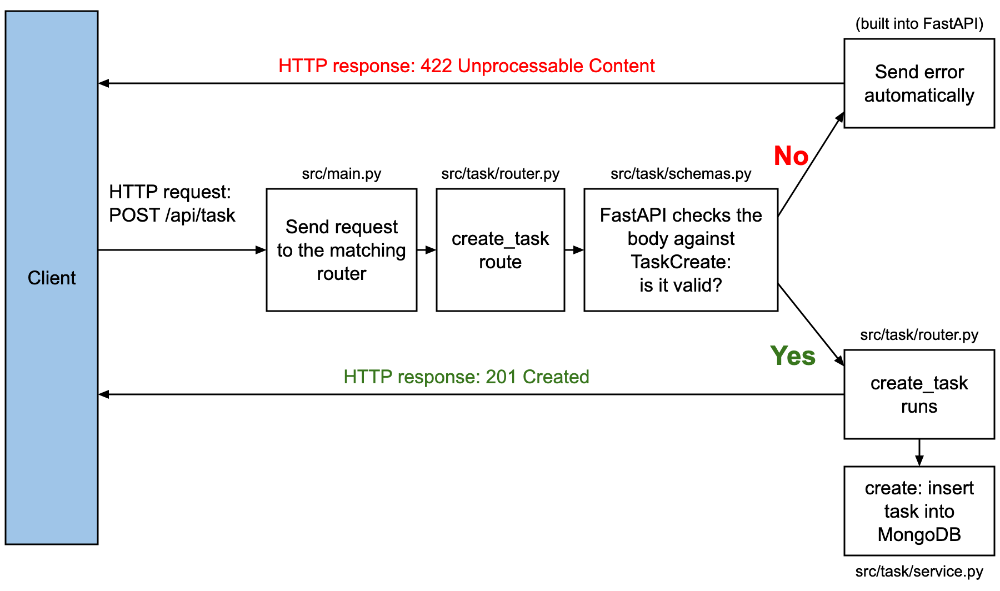

# 0.3. Explore the designs and code

## Explore the Figma designs

Before we look more closely at the code, let's check out the Figma designs for this todo app. As a developer, you'll need to know the basics of navigating Figma projects and translating designs into code. Follow the steps below to familiarize yourself with Figma, and feel free to explore further!

1. Open the [Onboarding Todo App Figma project](https://www.figma.com/file/8eRDNyOrYRgyN7NNb0mIXA/Onboarding-Todo-App).
2. If you're not signed in already, click "Log in" in the top right corner. Once you're signed in, you should see "View only" in the center of the top bar.
3. **Move the viewport:** Scroll or middle-click and drag to pan around. Pinch (trackpad) or scroll while holding `Ctrl` to zoom in and out.
4. **Select an element:** Click on an element in the main viewport or left sidebar to select it.
   1. Generally, Figma only lets you select an element if its parent (such as a frame or group) is currently selected, which can be unwieldy for deeply nested elements. To **select an element directly,** right-click on it in the viewport and choose "Select layer," then choose the element you want to select.
5. **Navigator panel:** The left sidebar has two sections: a page selector and a tree navigator.
   1. You should start out on the "Part 1" page, which contains all the designs we need for Part 1. Click on "Part 2" to view the Part 2 designs.
   2. In the tree navigator, you can click on an element to highlight it in the main viewport or click on the triangle next to it to show/hide its children.
6. **Properties and Export panels:** The right sidebar has three tabs at the top: Comment, Properties, and Export. We generally don't need to add comments as developers, so click on one of the other two tabs to see those panels.

   1. **Properties:** This panel shows style information from the currently selected element. If no element is selected, it shows a list of preset text and color styles which the designers have chosen.
      

      
<strong>❓ Hint: Style values</strong>

      _As of writing, in view-only mode this list doesn't actually tell you anything about the style values (color, font size, etc.), so to see those, you can either look at the properties of individual elements or ask your designers to write out all the values somewhere. For this todo app, all colors and font styles are defined already in the frontend starter code (see below), so you'll just need to match them to things in the Figma designs._
      

   2. **Export:** This panel allows you to export any element as an image. We'll use this while developing the todo app, and it's likely that your future TSE projects will also have some custom icons or graphics which you'll want to export. Follow the steps below to export an element.
      1. Select the element.
      2. In the Export panel, click the + next to the element you want to export.
      3. Choose a file type (PNG, JPG, SVG, or PDF). SVG is the best in most cases because it can display at any size.
      4. Click Export.

## Explore the repository contents

Finally, let's examine the structure of the project and some important files. Here we stay specific to our stack (MongoDB, FastAPI, React, and Node for the frontend tooling), but you'll see similar patterns across projects inside and outside of TSE, even those that use other tech stacks. Most of the files also have comments explaining what each part of the code does in greater detail, and we encourage you to read through those as well.

As we've seen, the repo has two main folders: `backend` and `frontend`. Note that this is just one way to organize a full-stack project. Some projects place the frontend code inside the backend directory, structure the backend route handlers differently, place frontend style and test files in their own folders, etc. It doesn't really matter what convention you follow, as long as you stay consistent within each project.

In a deployed project, the frontend and backend are often hosted on their own servers. Ours are even written in different languages: the backend runs in a Python environment, and the frontend runs in a Node environment. During development, we simulate this by placing them in separate directories and running each one on a different port (3001 for the backend and 5173 for the frontend).

### Backend files

- [`pyproject.toml`](/backend/pyproject.toml) **marks this folder as a Python project** and provides information so [uv](https://docs.astral.sh/uv/), our Python package manager, knows which Python version and packages the code needs. It's written in [TOML](https://toml.io/en/), a config format made of `key = value` pairs grouped under `[section]` headers. Some of the keys would only be relevant if we were publishing this as a library, so we'll just cover the ones that are important for us as developers. ([`pyproject.toml` guide](https://packaging.python.org/en/latest/guides/writing-pyproject-toml/))
  

  
<strong>Contents of pyproject.toml</strong>

  - `requires-python`: The **Python versions** that the code supports.
  - `dependencies`: List of **packages that we use** in our own code and the allowed version numbers. uv refers to this when it installs dependencies (`uv sync`), and it automatically updates it when we add another package (`uv add <package>`). Ours are [FastAPI](https://fastapi.tiangolo.com/) (the web framework), `fastapi-cli` (the `fastapi dev` command that runs it), [`pydantic-settings`](https://pydantic.dev/docs/validation/latest/concepts/pydantic_settings/) (reads our `.env` file), and [PyMongo](https://pymongo.readthedocs.io/en/stable/) (talks to MongoDB). See the [uv dependencies docs](https://docs.astral.sh/uv/concepts/projects/dependencies/) for more info about the syntax.
  - `[dependency-groups]`: The `dev` group lists **packages that we use only during development**: [Ruff](https://docs.astral.sh/ruff/) (linter and formatter), [mypy](https://mypy.readthedocs.io/en/stable/) (type checker), [pytest](https://docs.pytest.org/en/stable/) (testing framework), and `httpx2` (sends requests to the app in tests). If you run `uv add --dev <package>`, it adds the package to this group. `uv sync` installs these too, so the difference only matters when the code is deployed. See the [uv development dependencies docs](https://docs.astral.sh/uv/concepts/projects/dependencies/#development-dependencies) for more info.
  - `[tool.*]` sections: **Settings for our tools.** `[tool.ruff]` chooses which lint rules Ruff enforces (this is the Python counterpart of the ESLint config in our [linting repo](https://github.com/TritonSE/linters)), `[tool.mypy]` turns on mypy's strict mode so every function needs type hints, and `[tool.pytest]` tells pytest where our tests are. `[tool.uv]` tells uv that this is an app, not a library to publish.
  

- [`uv.lock`](/backend/uv.lock) **keeps track of the version of each dependency** which was last installed. This file is often quite large, and uv automatically updates it so there's generally no need to edit it manually. However, it's still very important to **include it in Git** because it ensures that different developers are using the same packages, thus avoiding conflicts. ([uv lockfile docs](https://docs.astral.sh/uv/concepts/projects/layout/#the-lockfile))
- [`.python-version`](/backend/.python-version) **pins the Python version** (3.14). uv reads it and downloads that version of Python for you if you don't have it, so everyone on the team runs the same Python.
- `.venv` is the backend's **virtual environment,** which `uv sync` creates. It **contains a copy of Python and the code from all our dependencies.** This folder is also often very large, and you generally won't need to look at anything inside it. Since `pyproject.toml` and `uv.lock` have all the information that uv needs to keep track of dependencies, we have Git ignore the `.venv` folder. ([uv project environment docs](https://docs.astral.sh/uv/concepts/projects/layout/#the-project-environment))
- [`Makefile`](/backend/Makefile) defines the **scripts we can run** with `make <target>`, like the `scripts` in a `package.json`. Each target is a list of shell commands. Most of them start with `uv run`, which runs a command inside `.venv` so it can use our dependencies. ([GNU Make manual](https://www.gnu.org/software/make/manual/make.html))
  

  
<strong>Contents of Makefile</strong>

  - `start` runs `uv run fastapi dev src/main.py --port 3001`, which starts the backend on port 3001 and **automatically restarts it** whenever you save a backend file. See the [FastAPI CLI docs](https://fastapi.tiangolo.com/fastapi-cli/) for more info.
  - `test` runs our automated tests with pytest.
  - `format`, `lint-fix`, and `lint-check` run Ruff (and, for `lint-check`, mypy) to scan our code for inconsistencies and type errors. `lint-fix` and `format` also fix what they can automatically. The pre-commit Git hook runs `make lint-check` before every commit.
  - `check-git-hooks` runs first in each lint target and checks that the Git hooks are installed. The hooks are installed when you run `npm install` in the `frontend` folder, so the lint targets fail until you've done that.
  

- [`src/main.py`](/backend/src/main.py) is the **entry point** of our backend code, meaning `fastapi dev` runs this file first. It creates the FastAPI `app`, adds a middleware that turns unexpected errors into `500 Internal Server Error` responses, sets up [CORS](https://fastapi.tiangolo.com/tutorial/cors/) so the frontend is allowed to call the backend, and includes the routes from each domain folder. FastAPI also generates **interactive API docs** for every route, which you can open at http://localhost:3001/docs while the backend is running.
- [`src/config.py`](/backend/src/config.py) **reads our settings** (`MONGODB_URI` and `FRONTEND_ORIGIN`) from `backend/.env` with [Pydantic Settings](https://pydantic.dev/docs/validation/latest/concepts/pydantic_settings/). If a setting is missing, the backend refuses to start and tells you which one.
- [`src/database.py`](/backend/src/database.py) **connects PyMongo to our MongoDB instance** when the app starts (in a [lifespan function](https://fastapi.tiangolo.com/advanced/events/)) and disconnects when it stops. If MongoDB isn't running, the backend gives up after 5 seconds and refuses to start. It also defines `Database`, a [dependency](https://fastapi.tiangolo.com/tutorial/dependencies/) that gives route functions access to the database.
- [`src/exceptions.py`](/backend/src/exceptions.py) defines the **error types shared by all domains,** such as `NotFound` (404) and `BadRequest` (400). Raising one of them in a route function makes FastAPI send an error response with that status code. ([FastAPI error handling docs](https://fastapi.tiangolo.com/tutorial/handling-errors/))
- [`src/task`](/backend/src/task/) contains **everything about tasks,** our only type of data so far. We organize the backend by **domain**: one folder per kind of data, each with the same four files. This is a common FastAPI convention (see [FastAPI best practices](https://github.com/zhanymkanov/fastapi-best-practices)) which TSE's FastAPI projects also use. When you add another kind of data later, you'll add another folder next to `task`.
  

  
<strong>Contents of src/task</strong>

  - `router.py` contains our **route functions.** Each **route** is a specific path where the frontend can send an HTTP request to trigger the corresponding function. In FastAPI, one decorated function is both the route definition and its request handler, so this is also where the business logic of each request starts. ([FastAPI bigger applications docs](https://fastapi.tiangolo.com/tutorial/bigger-applications/))
  - `schemas.py` contains our **Pydantic schemas** (`TaskCreate`, `TaskUpdate`, and `TaskResponse`). In general, a **schema** defines the expected "shape" of an object, including its field names and their data types. FastAPI checks each request body against a schema before the route function runs, so this is also our server-side **validation logic**: if the data have the wrong format, FastAPI responds with a `422 Unprocessable Content` error by itself. The response schema decides which fields are sent back to the frontend. ([FastAPI request body docs](https://fastapi.tiangolo.com/tutorial/body/), [Pydantic models docs](https://pydantic.dev/docs/validation/latest/concepts/models/))
  - `service.py` contains our **database queries** for the `tasks` collection, written with PyMongo. It converts between MongoDB documents and our schemas. ([PyMongo collection docs](https://pymongo.readthedocs.io/en/stable/api/pymongo/asynchronous/collection.html))
  - `exceptions.py` contains the **errors specific to tasks,** such as `TaskNotFound`, which builds on `NotFound` from `src/exceptions.py`.
  - `__init__.py` is empty. It marks the folder as a Python package so we can import from it (for example, `from src.task import service`). The `src` folder has one too.
  

- [`tests`](/backend/tests/) contains the backend's **automated tests,** which `make test` runs with pytest. The starter code only has one small test, which checks that the app starts and serves its API docs. ([FastAPI testing docs](https://fastapi.tiangolo.com/tutorial/testing/))

<strong>🤔 For new developers: Coming from Express?</strong>

_If you've built an Express backend before, here's roughly where each piece went:_

| Express                                       | FastAPI                                                               |
| --------------------------------------------- | --------------------------------------------------------------------- |
| `app.ts` + `server.ts`                        | `main.py` + `database.py`                                             |
| `util/validateEnv.ts`                         | `config.py`                                                           |
| `routes/task.ts` + `controllers/task.ts`      | `task/router.py` (a route function is both the route and the handler) |
| `validators/task.ts`                          | `task/schemas.py` (Pydantic validates request bodies automatically)   |
| `models/task.ts` (Mongoose model and queries) | `task/schemas.py` (shape) + `task/service.py` (PyMongo queries)       |
| Global error handler                          | FastAPI's built-in `HTTPException` handling + the 500 middleware      |
| `npm install` / `npm start` with nodemon      | `uv sync` / `make start` (`fastapi dev` restarts on save)             |

<strong>🤔 For new developers: How FastAPI runs this code</strong>

<em>

Let's trace what happens when the frontend sends a `POST /api/task` request to create a task, starting from `make start`.

1. `make start` runs `uv run fastapi dev src/main.py --port 3001`. `fastapi dev` imports `src/main.py`, finds the variable named `app`, and starts a server for it on port 3001.
2. In `main.py`, we create the app by calling `app = FastAPI(lifespan=lifespan)`. `lifespan` is imported from `database.py`, and FastAPI runs it when the server starts: it connects to MongoDB and makes the database available to our routes. Then we call `app.include_router(task_router)`, which tells FastAPI to handle every route defined in `task/router.py`.
3. In `task/router.py`, we create an `APIRouter` with `prefix="/api"`, so every path in this file starts with `/api`. Each route function has a decorator that specifies an HTTP method and a path suffix.
   1. `@router.get("/task/{task_id}")` above `get_task` handles requests to `GET /api/task/{task_id}` (where `{task_id}` is the ID of a task). FastAPI passes that part of the URL to the function as its `task_id` parameter. The `@router.delete` route works very similarly.
   2. `@router.post("/task", status_code=status.HTTP_201_CREATED)` above `create_task` handles requests to `POST /api/task`.
4. Before calling `create_task(data: TaskCreate, database: Database)`, FastAPI fills in its parameters. It validates the JSON request body against `TaskCreate` from `task/schemas.py`, which says a task has a required string `title` (at least 1 character), an optional string `description`, and an optional boolean `isChecked`. If the body doesn't match, FastAPI responds with a 422 error and never calls `create_task`. It also gets the `Database` dependency by calling `get_database` in `database.py`.
5. `create_task` calls `service.create` in `task/service.py`, which adds the current date as `dateCreated` and inserts the task into the `tasks` collection with PyMongo's `insert_one`. MongoDB automatically gives each document its own [unique ID](https://www.mongodb.com/docs/manual/reference/bson-types/#std-label-objectid) in a field called `_id`.
6. `service.create` returns a `TaskResponse`, the function's return type. FastAPI converts it to JSON, using the name `_id` for its `id` field, and sends it with a 201 status. Optional fields that weren't set come back as `null`, for example `{"title": "Buy groceries", "description": null, "isChecked": false, "_id": "6afe72e8e6113f215e611987", "dateCreated": "2026-11-19T03:54:16.219000Z"}`.

</em>

Example request flow: creating a new task

### Frontend files

- [`package.json`](/frontend/package.json) **denotes a Node package,** much like `pyproject.toml` does for the backend's Python project. It lists the frontend's `dependencies` and `devDependencies`, and its `scripts` (run with `npm run <script-name>`) play the same role as the backend's `Makefile`. Similarly, `package-lock.json` keeps track of installed versions like `uv.lock`, and the `node_modules` folder contains the installed packages like `.venv`. Its `prepare` script runs automatically after every `npm install` and installs our Git hooks with [Husky](https://typicode.github.io/husky/), which is why we run `npm install` in the `frontend` folder first. ([`package.json` documentation](https://docs.npmjs.com/cli/v10/configuring-npm/package-json))
- [`index.html`](/frontend/index.html) contains the actual HTML document **where React injects all of its generated HTML** in the browser. Since we write all our pages and components in React, this is the only HTML file needed in the entire project. The file itself was generated by Vite, and we added some extra code to download the Rubik font from Google Fonts and tell the browser where the site favicon is located.
- [`src/main.tsx`](/frontend/src/main.tsx) is our **frontend's entry point.** It tells React where to inject our content in `index.html` and renders the `App` component from `src/App.tsx`.
- [`src/App.tsx`](/frontend/src/App.tsx) is the **root of our React application** code, where we set up `react-router` with our frontend pages. Note that the "routes" in this file are different from our backend API routes—here, we map each page to its own URL for the purpose of client-side routing. In general, the only other code in `App.tsx` should be things that we want to make available to all parts of the application.
- [`src/pages`](/frontend/src/pages/) stores the **pages of our frontend.** We currently have two pages: Home and About. The Home page displays a form for creating new tasks, while the About page contains some simple text (mainly to demonstrate how to link to another page).
  

  
<strong>✅ Good practice: Unique page URLs</strong>

  _Now that the industry has more advanced frontend technologies like React instead of raw HTML/CSS, the concept of a website "page" is a little more fluid than before. For instance, one React JavaScript file can dynamically render multiple different pages under the same URL. We still recommend mapping pages and URLs one-to-one for the purpose of keeping certain functionalities, like bookmarking pages._
  

- [`src/components`](/frontend/src/components/) contains code for our **React components.** Each **component** is a reusable element of the frontend, such as a button, popup, or search bar. We write our components in [JSX](https://react.dev/learn/writing-markup-with-jsx), which is an extended, React-specific version of JavaScript/TypeScript that allows us to write HTML-like code directly in our JS/TS files.
  

  
<strong>🤔 For new developers: Components and modularity</strong>

  _The idea of components isn't unique to React, but it's definitely one of its defining characteristics. By writing different parts of our frontend into components, we make them more **modular**—easier to think about, reuse, and extend. Also, the "pages" of our application are technically React components too, but it's more helpful to separate them as a different type of abstraction._
  

  

  
<strong>Contents of src/components</strong>

  - `Button` and `TextField` are the smallest and most reusable components. Because we'd expect these kinds of elements to be used in a lot of different ways, they are written generically, with lots of options. See the Figma file for illustrations of each component's variations.
  - `HeaderBar` is also a small component, but because we know it will only be used in one way (at the top of every page), we don't need to add any options.
  - `TaskForm` is the task creation form that you see on the Home page. It uses both `Button` and `TextField`. Note that this component contains both rendering logic (what gets displayed to the user) and some business logic (performing some operations when the user clicks Save). This is common in medium-to-large components—as the size of the component increases, so does the amount of logic it encapsulates.
  - The **CSS files** (ending in `.css`) in this folder provide styles to our components, including colors, fonts, borders, positioning, etc. We actually use CSS Modules (hence the `.module.css`; automatically enabled with CRA) so that the styles in each file only get applied to components that specifically import those styles.
  - The **test files** (ending in `.test.tsx`) in this folder define automated unit tests for each component, which are helpful for preventing regressions (unintentionally breaking things when we make changes). We use [Vitest](https://vitest.dev/guide/) and [React Testing Library](https://testing-library.com/docs/react-testing-library/intro/) to run these tests. There is only one test file in the starter code, `TaskForm.test.tsx`, because that's the only component with enough complexity to merit testing. In TSE, we generally encourage automated testing of medium-complexity components and helper functions, including on the backend if worthwhile.
  

- [`src/api`](/frontend/src/api/) contains our **frontend API client**—a set of helper functions that send HTTP requests to our backend routes, which we discussed above, and parse the responses. No frontend page or component should send any HTTP requests directly; instead, they should call these functions. We recommend gathering all the API request code in one place like this to make it easier to understand and maintain.
- [`src/globals.css`](/frontend/src/globals.css) contains the application's **global styles.** This includes things like app colors and fonts, common text styles, and other styles that we want to apply to everything in the application. We can also override these styles with more specific CSS Modules stylesheets.

With that massive exposition dump over, take a deep breath. You made it, now let's start coding!

| Previous                                         | Up           | Next                                         |
| ------------------------------------------------ | ------------ | -------------------------------------------- |
| [0.2. Clone and run the project](./0-2-Clone.md) | [Part 0](./) | [Part 1. Minimum viable product](../part-1/) |
